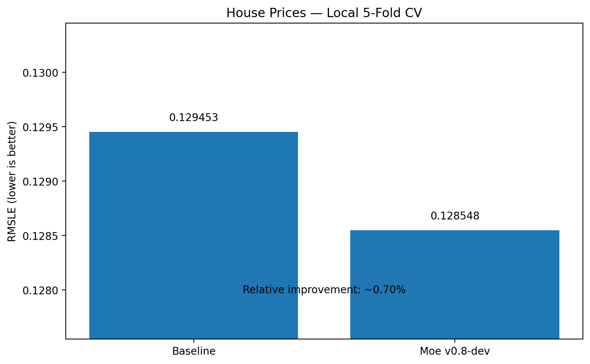
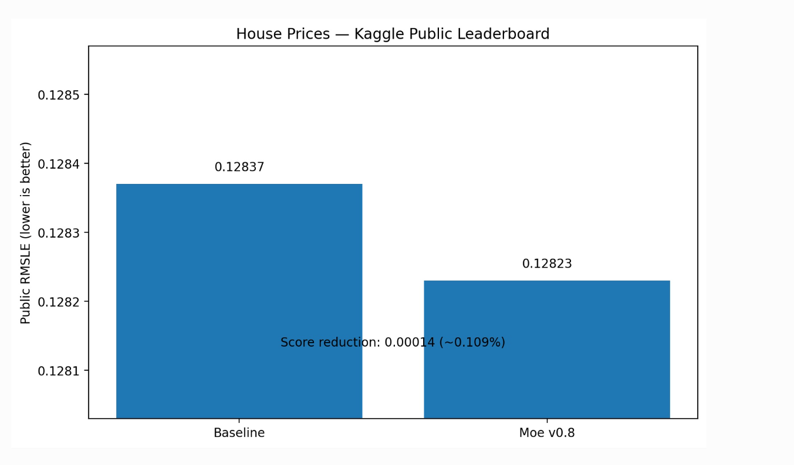

# House Price Prediction — Kaggle + Moe

## Project Overview

This project evaluates a private model-reliability system on the Kaggle
House Prices competition.

The objective was to test whether a secondary reliability layer could improve
a strong baseline prediction system on structured real-estate data.

The internal Moe implementation is private.

---

## Problem

Predict residential property sale prices.

Target:

`SalePrice`

Evaluation metric:

`RMSLE`

Lower is better.

---

## Verified Local Result

| Model | RMSLE |
|---|---:|
| Baseline | 0.1294528 |
| Moe v0.8-dev | 0.1285477 |

Approximate relative improvement:

**~0.70%**

The aggregate cross-validation score improved.

---

## Kaggle Public Leaderboard

| Submission | Public Score |
|---|---:|
| Baseline | 0.12837 |
| Moe v0.8 | 0.12823 |

Public score reduction:

**0.00014 RMSLE**

Approximate relative improvement:

**~0.109%**

---

## Key Finding

The experiment produced a measurable improvement locally and on the Kaggle
public leaderboard.

The experiment also revealed reliability limitations that influenced later
development of Moe.

Detailed internal discovery, scoring, validation, and correction logic is not
published.

---

## Skills Demonstrated

- Real-estate regression
- Tabular machine learning
- Cross-validation
- Model comparison
- Error analysis
- Kaggle workflow
- Experimental ML design
- Evidence-based reporting
- Model reliability analysis

---

## Evidence Classification

**LEGACY / DEVELOPMENTAL EXTERNAL EVIDENCE**

This experiment was part of Moe's development process and is not presented as
frozen post-development generalization evidence.

---

## Results Visuals

### Local Cross-Validation

### Kaggle Public Leaderboard

---

## Private Implementation

The Moe algorithm and implementation are maintained privately.
